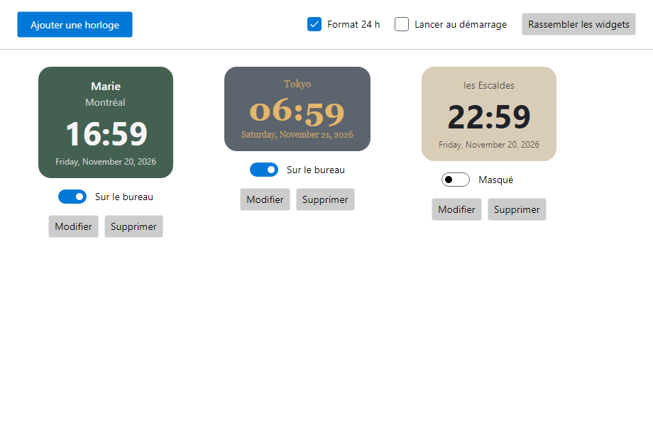
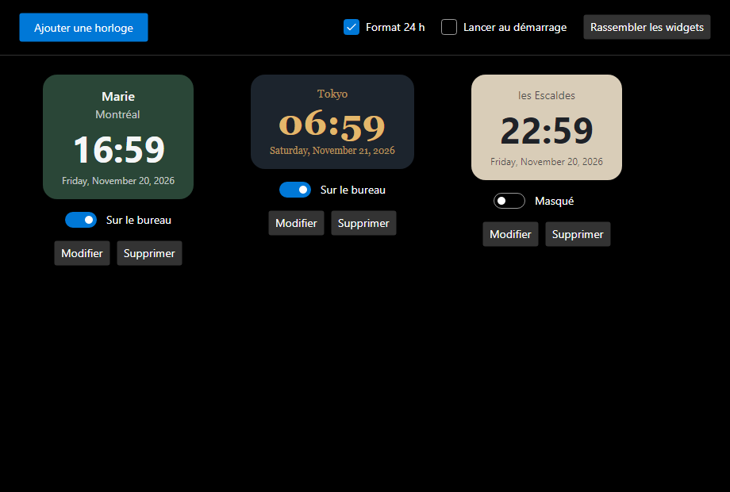

# WorldClockr

Time zone clocks pinned to your desktop: one widget per city or per person, in plain colors, that you drag anywhere on any screen.

**[Download the latest version](https://github.com/nicolasdev/worldclockr-releases/releases/latest)** for Windows or macOS.

## Features

- **Desktop widgets**: each clock sits on the desktop, under your windows, on any screen. Drag it where you want; its position is remembered.
- **Any city, country or time zone**: search more than 34,000 cities by name (French names work too, such as "Londres"), a country ("Japon", "JP") or an IANA time zone ("Europe/Paris").
- **Your own text**: add a name above the clock, for example the person you call in that city, and show or hide it.
- **Plain colors**: background and text color per clock, from a sober palette or any custom color, with an adjustable background opacity, and a font per clock.
- **A switch per clock** shows or hides its widget on the desktop.
- 24-hour or 12-hour format, start with the computer. The interface is in French; the date follows the language of your system.

## Install

Download the installer for your system from the [latest release](https://github.com/nicolasdev/worldclockr-releases/releases/latest):

| System | File |
|---|---|
| Windows (x64) | `WorldClockr-<version>-win-x64.exe` |
| macOS, Apple Silicon | `WorldClockr-<version>-mac-arm64.dmg` |
| macOS, Intel | `WorldClockr-<version>-mac-x64.dmg` |

On macOS, open the disk image and drag WorldClockr to Applications.

The installers are not code-signed yet, so the first launch shows a warning:

- **Windows**: on "Windows protected your PC", click **More info**, then **Run anyway**.
- **macOS**: the first launch is blocked. Open **System Settings → Privacy & Security** and click **Open Anyway** next to the message about WorldClockr.

## Usage

| Action | How |
|---|---|
| Add a clock | **Ajouter une horloge**, then search a city, a country or a time zone and pick a result |
| Move a widget | Drag it |
| Edit a clock | **Modifier** in the list, or right-click the widget → Modifier… |
| Show or hide a widget | The **Sur le bureau** switch in the list, or right-click the widget → Retirer du bureau |
| Bring every widget back to the main screen | **Rassembler les widgets** |
| Open the window | The WorldClockr icon in the notification area (Windows) or the menu bar (macOS), or start WorldClockr again |
| Quit | The same icon → **Quitter**. Closing the window keeps the widgets on the desktop |

## Privacy

WorldClockr runs on your computer and sends nothing over the network. Its settings are stored in `%APPDATA%\WorldClockr` (Windows) or `~/Library/Application Support/WorldClockr` (macOS); uninstalling keeps them.

## Good to know

- The widgets stay just above the desktop: your windows cover them, and they show again when the desktop is clear.
- Linux is not supported yet.

## Feedback

**Found a bug?** [Open an issue](https://github.com/nicolasdev/worldclockr-releases/issues/new) with your WorldClockr version and the steps that lead to it. It needs a free GitHub account.

## Credits

City and time zone data from [GeoNames](https://www.geonames.org), under [CC BY 4.0](https://creativecommons.org/licenses/by/4.0/). Country names from the [Unicode CLDR](https://cldr.unicode.org).

## License

WorldClockr is freeware: free to use, for personal or commercial purposes. See [LICENSE](LICENSE).
