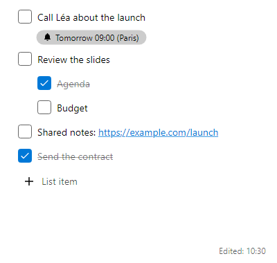
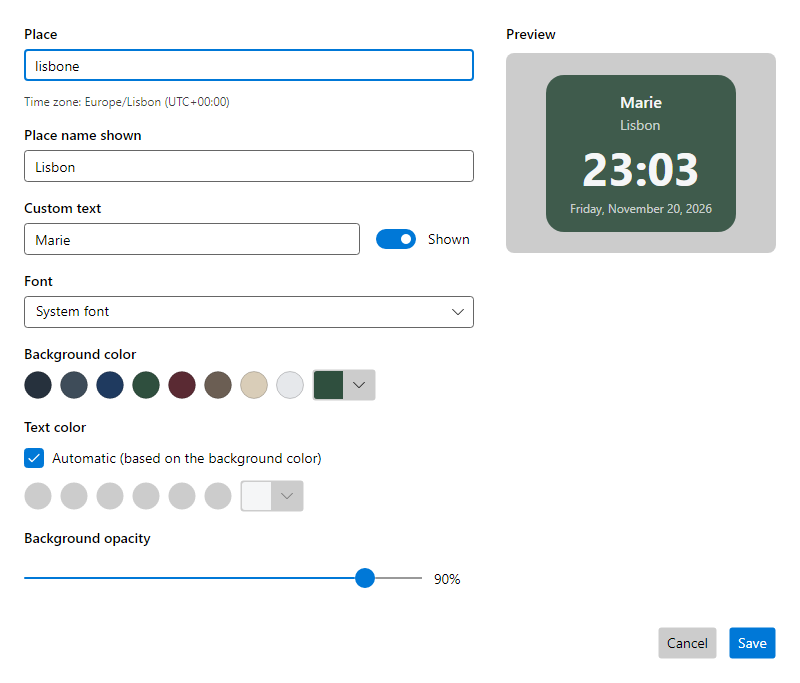

# WorldClockr

Time zone clocks pinned to your desktop: one widget per city or per person, in plain colors, that you drag anywhere on any screen.

**[Download the latest version](https://github.com/nicolasdev/worldclockr-releases/releases/latest)** for Windows or macOS.

## Features

- **Desktop widgets**: each clock sits on the desktop, under your windows, on any screen. Drag it where you want; its position is remembered. New clocks line up side by side.
- **Any city, country or time zone**: search more than 34,000 cities by name (French names work too, such as "Londres"), a country ("Japon", "JP") or an IANA time zone ("Europe/Paris").
- **Your own text**: add a name above the clock, for example the person you call in that city, and show or hide it.
- **Plain colors**: background and text color per clock, from a sober palette or any custom color, with an adjustable background opacity, and a font per clock.
- **Size**: every clock has the same size, adjustable from 50 to 200 %, per clock or for all of them at once.
- **Working hours**: the border of a clock shows whether you can reach that city. It is green during its working hours, then turns yellow, orange and red before the end, and red outside them; a color announces the start. The hours, the days, the five colors and when each color shows are set per clock.
- **Common hours**: the round button at the bottom right of the main window shows when the clocks you check are all within their working hours, day by day. Each common range is given at your computer's time, with its duration and whether it is on now, then at the time of each clock. A 24-hour timeline shows the working hours of each clock and frames the common ones. Your checks are remembered.
- **A task list per clock**: the button at the top right of a clock opens its list, like a checklist in a note app: check marks that strike through, one level of sub-tasks, drag to reorder, and web addresses that open in your browser. Each task shows the date and time it was created on the left and its reminder on the right. The button shows how many tasks are left.
- **Markdown export**: **Copy as Markdown**, at the bottom of a task list, puts it on the clipboard as a checklist, with the creation date and the reminder of each task; done tasks are struck through.
- **Reminders**: each task can have a reminder, in the clock's time zone or your computer's. When it is due, the reminder turns red with an **Overdue** label, and the clock's border blinks slowly until the task is checked.
- **Built-in help**: the question mark next to the gear opens a guide to the whole app, in the app's language, with a search that looks through every section.
- **New versions**: once a day, WorldClockr asks GitHub for the latest version. When a newer one is out, a red dot shows on the gear, and the settings give its number with a **Download** link to its page. It can be turned off.
- **A switch per clock** shows or hides its widget on the desktop.
- **Light or dark theme**, 24-hour or 12-hour format, start with the computer, and on Windows, a minimized window that leaves the taskbar for the notification area.
- Interface in **English, French and Spanish**; the dates follow the interface language.

## Install

Download the installer for your system from the [latest release](https://github.com/nicolasdev/worldclockr-releases/releases/latest):

| System | File |
|---|---|
| Windows (x64) | `WorldClockr-<version>-win-x64.exe` |
| macOS, Apple Silicon | `WorldClockr-<version>-mac-arm64.dmg` |
| macOS, Intel | `WorldClockr-<version>-mac-x64.dmg` |

On macOS, open the disk image and drag WorldClockr to Applications.

The installers are not code-signed yet, so the first launch shows a warning:

- **Windows**: on "Windows protected your PC", click **More info**, then **Run anyway**.
- **macOS**: the first launch is blocked. Open **System Settings → Privacy & Security** and click **Open Anyway** next to the message about WorldClockr.

## Usage

| Action | How |
|---|---|
| Add a clock | **Add a clock**, then search a city, a country or a time zone and pick a result (arrows and Enter work too) |
| Move a widget | Drag it |
| Edit a clock | Double-click it in the main window, or the pencil button under it, or right-click the widget → Edit… |
| Change the size of the clocks | Edit a clock → **Settings** tab; tick **Apply this size to all clocks** to resize them all |
| Color the border with the working hours | Edit a clock → **Working hours** tab |
| See when several clocks are all at work | The round button at the bottom right of the main window: check the clocks to compare, and change the day with ‹ and › |
| Keep tasks for a clock | The list button at the top right of the clock. Enter adds a task, Tab makes it a sub-task, Backspace on an empty task deletes it, the handle reorders |
| Set a reminder | The bell on a task: date, time, and the clock's time zone or your computer's |
| Copy a task list | **Copy as Markdown** at the bottom of the list, then paste it in a note or a message |
| Show or hide a widget | The switch under the clock in the list, or right-click the widget → Remove from the desktop |
| Delete a clock | The trash button under the clock in the list, then confirm |
| Line the widgets up on the main screen | **Arrange the clocks** |
| Language, theme, 24-hour format, start with the computer, new versions | The gear button at the top right of the main window |
| Read the help | The question mark next to the gear; type in its search box to look through every section |
| Open the window | The WorldClockr icon in the notification area (Windows) or the menu bar (macOS), or start WorldClockr again |
| Quit | The same icon → **Quit**. Closing the window keeps the widgets on the desktop |

## Privacy

WorldClockr runs on your computer. Its only network connection is a request to GitHub, once a day, for the number of the latest version: it carries no account or identifier, though GitHub, like any website, sees your IP address. Turn it off with **Check for new versions** in the settings. Its settings are stored in `%APPDATA%\WorldClockr` (Windows) or `~/Library/Application Support/WorldClockr` (macOS); uninstalling keeps them, and a new version picks them up.

## Good to know

- The widgets stay just above the desktop: your windows cover them, and they show again when the desktop is clear.
- Working hours are those of the clock's time zone. Common hours are given for a day of your computer's calendar.
- Linux is not supported yet.

## Feedback

- **Found a bug?** [Open an issue](https://github.com/nicolasdev/worldclockr-releases/issues/new/choose) with your WorldClockr version and the steps that lead to it.
- **An idea or a suggestion?** Post it in [Ideas](https://github.com/nicolasdev/worldclockr-releases/discussions/categories/ideas), where others can vote for it.

Both need a free GitHub account.

## Credits

City and time zone data from [GeoNames](https://www.geonames.org), under [CC BY 4.0](https://creativecommons.org/licenses/by/4.0/). Country names from the [Unicode CLDR](https://cldr.unicode.org).

## License

WorldClockr is freeware: free to use, for personal or commercial purposes. See [LICENSE](LICENSE).
